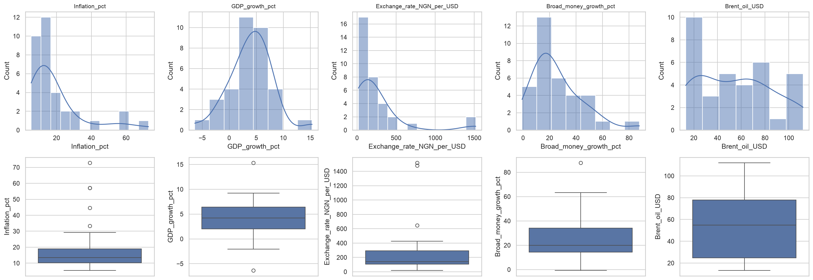
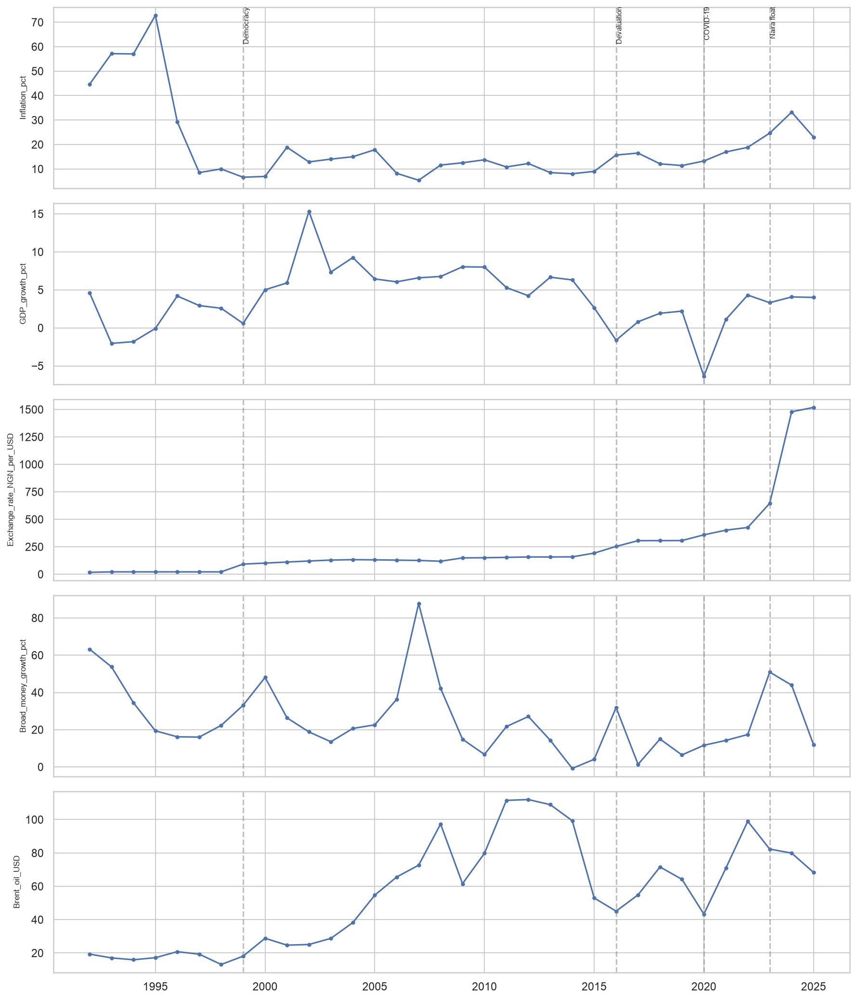
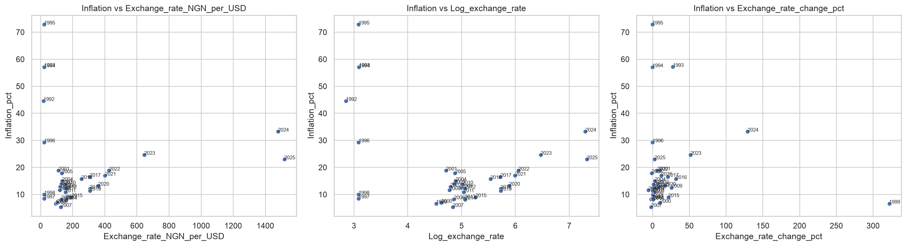
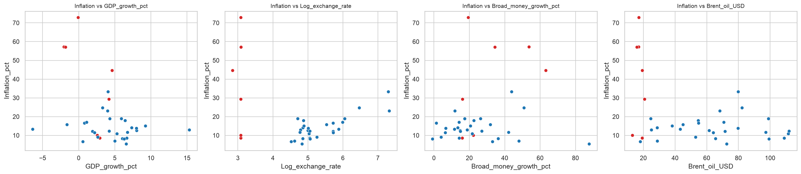
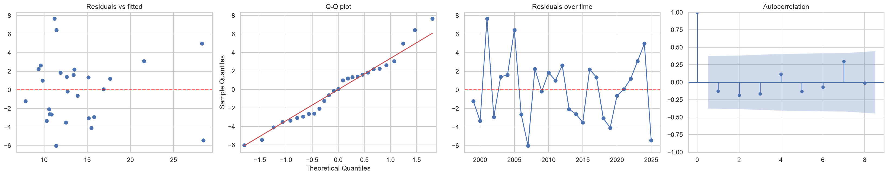

# What Drives Inflation in Nigeria? A Regression Study, 1992-2025

I wanted to know which economic variables carry real weight in explaining Nigeria's annual inflation rate, and which only look important until you test them. This project runs that test with linear regression in Python, using statsmodels for the F-statistics and p-values and scikit-learn as a cross-check.

## Short answer

The naira-dollar exchange rate is the only predictor that holds up. Measured on a log scale, it was positive and statistically significant in every version of the model I ran. GDP growth, broad money growth and Brent crude oil did not hold up.

The second finding matters as much as the first. Nigeria's economy in 1992-1998 behaved differently from the years after it, and including those seven years flips the sign of the exchange rate effect. A model fitted to the full period gives a misleading answer.

## Question and data

**Dependent variable:** annual inflation rate (consumer prices, %).

**Independent variables:**

| Variable | Source | Code |
|---|---|---|
| GDP growth (annual %) | World Bank, World Development Indicators | NY.GDP.MKTP.KD.ZG |
| Official exchange rate (naira per US dollar, period average) | World Bank, World Development Indicators | PA.NUS.FCRF |
| Broad money growth (annual %) | World Bank, World Development Indicators | FM.LBL.BMNY.ZG |
| Brent crude oil price (US dollars per barrel, annual average) | FRED | POILBREUSDA |

Inflation comes from the same World Bank source (FP.CPI.TOTL.ZG). The sample runs from 1992, the first year Brent data exists in the FRED series, to 2025. That gives 34 annual observations, with no missing values.

I left out the real interest rate on purpose. It is calculated from inflation, so using it as a predictor would feed the dependent variable back into the model.

## Data preparation

The raw World Bank files cover every country and carry four metadata rows above the header. The workbook in this repo keeps those files untouched on separate sheets, then builds a `Clean_Data` sheet that pulls only Nigeria and only 1992-2025. A `Cleaning_Log` sheet records each decision.

## Exploratory analysis

Skewness (0 means symmetric; above 1 means a long tail):

| Variable | Skewness |
|---|---|
| Inflation | 2.09 |
| Exchange rate (raw) | 3.01 |
| Broad money growth | 1.34 |
| Brent crude | 0.29 |
| GDP growth | 0.02 |





Three things stood out.

1. **The raw exchange rate is a poor regression input.** It sits near 22 naira per dollar until 1998 and reaches about 1,518 by 2025, and three recent years (2023-2025) dominate the range. Taking the log brought skewness from 3.01 to -0.12. Using year-on-year % change was worse, at 4.53, because of a jump of roughly 320% in 1999.
2. **1992-1998 is a different regime.** Inflation ran between 29% and 73% while the official exchange rate stayed flat. In the full sample, log exchange rate correlates with inflation at -0.40. From 1999 onward the correlation is +0.77.
3. **Multicollinearity depends on the period.** Log exchange rate and Brent correlate at 0.62 in the full sample and 0.25 after 1998.

Inflation against the exchange rate in three forms: raw level, log, and year-on-year % change.



Correlations in the full sample and after 1998. The exchange rate row flips from negative to strongly positive.



Each predictor against inflation, with 1992-1998 in red. The early years sit apart from the rest.


For the main model I used 1999-2025 (27 observations), and I report the full-sample model alongside it for comparison.

## Main model (1999-2025)

`Inflation = b0 + b1(GDP growth) + b2(log exchange rate) + b3(broad money growth) + b4(Brent) + error`

Overall fit: F = 12.09 on (4, 22) degrees of freedom, p = 0.00002. R² is 0.687 and adjusted R² is 0.630.

| Predictor | Coefficient | p-value | Standardized beta |
|---|---|---|---|
| Log exchange rate | 7.68 | < 0.001 | 0.94 |
| GDP growth | 0.44 | 0.043 | 0.28 |
| Brent crude | -0.04 | 0.147 | -0.19 |
| Broad money growth | 0.01 | 0.706 | 0.05 |

A 1% weaker naira goes with inflation about 0.077 percentage points higher, holding the other variables constant. A doubling of the exchange rate goes with roughly 5.3 points.

Fitted one predictor at a time, the F-statistics make the ranking plain:

| Predictor | F | p-value | R² |
|---|---|---|---|
| Log exchange rate | 37.17 | < 0.001 | 0.598 |
| GDP growth | 0.21 | 0.648 | 0.009 |
| Brent crude | 0.08 | 0.784 | 0.003 |
| Broad money growth | 0.01 | 0.943 | 0.000 |

Fitted on the full 1992-2025 sample, the same four-variable model gives F = 3.31, adjusted R² = 0.22, and a log exchange rate coefficient of -3.49 (p = 0.21). That is the wrong sign, caused by the early years.

## Robustness checks

The exchange rate result survived every test I tried:

| Specification | Log exchange rate coefficient | p-value |
|---|---|---|
| Main model, 1999-2025 | 7.68 | < 0.001 |
| Dropping 2023-2025 | 5.59 | 0.029 |
| Dropping 2007 (most influential year) | 7.37 | < 0.001 |
| Full sample with a 1992-1998 dummy variable | 6.20 | 0.087 |
| Predictors lagged one year | 7.80 | < 0.001 |

The effect gets weaker without 2023-2025 and its confidence interval widens a lot, so the size of the effect is uncertain even though its direction is not.

The other predictors were less stable. GDP growth reached p = 0.043 in the main model, but lost significance without 2023-2025 (p = 0.153) and turned negative in the dummy-variable model. Broad money growth looked dead in the main model until I dropped 2007, when money grew about 88% and inflation was only about 5%. Without that year its p-value falls to 0.060. I treat it as inconclusive.

Other checks:

- **Multicollinearity:** variance inflation factors range from 1.01 to 1.30.
- **Residuals:** Durbin-Watson is 2.15, Jarque-Bera p = 0.75, Breusch-Pagan p = 0.25, and the autocorrelation plot shows nothing outside the confidence band.
- **Standard errors:** switching to heteroskedasticity-consistent (HC3) errors leaves the conclusions unchanged; the exchange rate p-value is 0.0002.
- **Do the other three predictors add anything?** A partial F-test comparing the full model with exchange rate alone gives F = 2.10, p = 0.13. They don't add significantly.
- **Model choice:** exchange rate alone has adjusted R² of 0.582, AIC of 153.06 and BIC of 155.65. The four-predictor model has 0.630, 152.27 and 158.75. AIC is nearly a tie and BIC prefers the smaller model.

Residual diagnostics for the main model: residuals against fitted values, a Q-Q plot, residuals over time, and the autocorrelation function.



## Out-of-sample check

I trained on 1999-2018 and tested on 2019-2025, keeping the years in order.

| Model | Test RMSE | Test R² |
|---|---|---|
| Predict the training average | 10.86 | n/a |
| Exchange rate only | 6.48 | 0.13 |
| All four predictors | 6.65 | 0.08 |

Both models cut the error by about 40% compared with the baseline, but they explain little of the year-to-year movement. The test set is seven years, and the 2023-2025 exchange rates fall outside the training range. I read this as a sanity check, not as proof of forecasting skill.

## Limitations

- **27 annual observations** is a small sample, and a single year (2007) moved one coefficient noticeably.
- **This shows association, not causation.** A weaker naira can raise prices, and high inflation can weaken the naira.
- **The 1992-1998 exclusion is a judgment call.** I made it based on the data and the fixed-rate history, and the dummy-variable model is there to show the result doesn't depend entirely on it.
- **Residuals for 2022-2024 are all positive**, so the model under-predicts inflation in those years. I haven't tested why.
- **Annual data hides timing.** Quarterly or monthly series could show lags that annual averages smooth over.

## Repository contents

| File | Description |
|---|---|
| `nigeria_inflation_dataset.xlsx` | Raw downloads, the cleaned sheet, and a cleaning log |
| `nigeria_inflation_clean.csv` | Cleaned data used in the notebook |
| `eda_nigeria_inflation.ipynb` | Full analysis: EDA, models, diagnostics, train/test check |
| `README.md` | This file |

## Reproducing the analysis

```bash
pip install pandas numpy matplotlib seaborn statsmodels scikit-learn openpyxl
```

Open the notebook in VS Code or Jupyter, keep the CSV in the same folder, and run the cells in order. Data was downloaded from the World Bank and FRED in October 2026; later releases may revise recent years.

## Author

Clinton Shodamola, [github.com/CxL1247](https://github.com/CxL1247)
